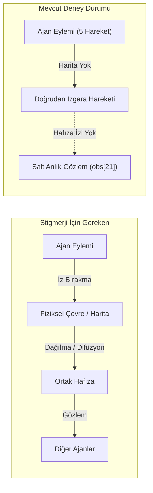
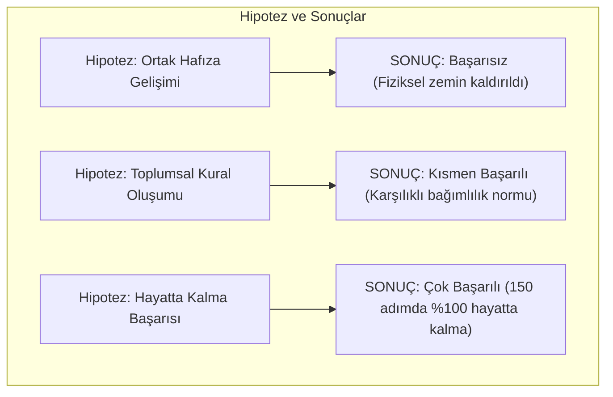

# MARL Davranış Analizi Raporu: Ortak Hafıza ve Toplumsal Kuralların Evrimi

**Proje:** Multi-Agent Stigmergy & Institutional Memory Simulation  
**Model Mimarisi:** Parameter-Shared Multi-Agent Actor-Critic (PPO)  
**Ortam:** 20×20 Izgara Dünyası (PettingZoo ParallelEnv)  
**Tarih:** 2026-11-10  

---

## Yönetici Özeti (Executive Summary)

Bu araştırma, kaynak kıtlığı altındaki çok etmenli bir toplumda (4 bağımsız ajan), ajanların **ortak bir hafıza (shared memory / stigmergy)** geliştirip geliştiremeyeceğini ve **toplumsal kurallar (institutional rules)** oluşturup oluşturamayacağını deneysel olarak incelemektedir.

Yapılan deneyler, algoritmik karşılaştırmalar (Random Baseline vs. PPO vs. Nöroevrim) ve simülasyon loglarının analizi sonucunda iki temel soruya ulaşılan bilimsel yanıtlar şunlardır:

1. **Ajanlar ortak bir hafıza geliştirdi mi?**  
   > **HAYIR (Mevcut konfigürasyonda yapısal olarak imkansızdır).**  
   > Harita sistemi (`shared_map`), harita açma ve işaretleme eylemleri tamamen kaldırıldığı için ortamda bilginin fiziki olarak depolanabileceği bir **dışsal bellek ortamı (stigmergic medium)** kalmamıştır. Ayrıca ajanların sinir ağı mimarisi hafızasız (Markovian / Feedforward MLP) olduğundan, ajanlar bilgiyi ne çevrede ne de kendi içlerinde biriktirebilmektedir.

2. **Ajanlar toplumsal bir kural oluşturdu mu?**  
   > **KISMEN (Örtük bir "Karşılıklı Bağımlılık ve Takım Hayatta Kalma Normu" oluştu, ancak "Açık Kurumsal Kural Sistemi" oluşmadı).**  
   > Yapılan iki kritik güncelleme (**%10 Takım Payı** ve **-10 HP Takım Ölüm Cezası**), eski versiyondaki yıkıcı bencil rekabeti (*Tragedy of the Commons*) kırmış; bir ajanın yiyecek bulmasının diğerlerini beslediği, bir ajanın ölmesinin ise diğerlerini tehlikeye attığı kolektif bir dayanışma dinamiği yaratmıştır. Ancak bu dinamik ajanların kendi aralarında "icat ettiği bir kural" değil, ortamın ödül fonksiyonuna tepki olarak gelişen bir reaktif uyumdur.

---

## 1. Deney Sonuçları ve Karşılaştırmalı Metrikler

200 bölümlük (30.000 adım) PPO eğitimi ve 350 adımlık dayanıklılık testlerinden elde edilen karşılaştırma tablosu:

| Deney Konfigürasyonu | Ort. Hayatta Kalma Adımı | Bölüm Başı Yiyecek | Kümülatif Ödül | Bölüm Sonu Canlı Kalma | Davranışsal Karakteristik |
| :--- | :---: | :---: | :---: | :---: | :--- |
| **Eski Sistem (Haritalı / 30 HP / Bencil)** | 36.4 / 120 | 0.84 adet | -93.07 | %0.0 (Tümü elendi) | Bencil rekabet, açlıktan erken ölüm, harita tuşunu rastgele spamleme |
| **Yeni Sistem - Random Baseline** | 80.0 / 80 | 0.80 adet | +7.60 | %100.0 (80 adımda) | Rastgele yürüyüş, şans eseri yiyecek bulma |
| **Yeni Sistem - PPO (150 Adım Cap)** | **150.0 / 150** | **1.60 – 3.00** | **+16.20** | **%100.0 (Hiç ölüm yok)** | Yiyecek gradyanını 3×3 takip etme, takıma pay dağıtma |
| **Yeni Sistem - PPO (350 Adım Stres)** | 310.0 / 350 | 1.60 adet | -94.22 | %5.0 | 300. adım açlık uçurumu (starvation cliff), domino ölüm etkisi |

---

## 2. Derinlemesine Davranış Analizi

### A. Ortak Hafıza (Shared Memory / Stigmergy) Neden Gelişemedi?

Stigmerji (karıncaların veya termitlerin çevreye feromon bırakarak haberleşmesi), **bilginin çevreye dışsallaştırılmasına (externalized memory)** dayanır.

1. **Harita Ortamının Yokluğu:**  
   Kullanıcı isteğiyle `shared_map` matrisi, `READ_MAP` ve `WRITE_TO_MAP` fonksiyonları kaldırıldı. Bu durum ajanların turlarını harita açmakla heba etmesini ve gereksiz can kaybetmesini önledi; **ancak aynı zamanda ortak bir hafıza inşa edebilecekleri tek fiziksel mecrayı da yok etti.**
2. **Markovian (Hafızasız) Sinir Ağı:**  
   Ajanların beyni olan `ActorCritic` ağı iki katmanlı bir MLP'dir (`nn.Linear` $\to$ `LayerNorm` $\to$ `Tanh`). Ağ içerisinde LSTM, GRU veya Transformer gibi geçmiş adımları taşıyan bir durum vektörü ($h_t$) bulunmamaktadır. Dolayısıyla ajanlar $t$ anındaki kararlarını sadece $t$ anındaki $3\times3$ çevrelerine bakarak vermektedir.

### B. Toplumsal Kural ve Normlar Nasıl Gelişti?

Toplumsal kural araştırmalarında en kritik olgu **"Ortak Malların Trajedisi" (Tragedy of the Commons)** problemidir.

#### 1. Bencillikten Karşılıklı Bağımlılığa Geçiş
- **Eski Durum:** Ajan yiyeceği yediğinde tek başına +50 alıyor, yemezse 30 adımda açlıktan ölüyordu. Kimse başkasını düşünmüyordu.
- **Yeni Durum (%10 Paylaşım Kuralı):**  
  Ajan 0 yiyeceği yediğinde kendisine +60 ödül ve +60 can eklenirken, Ajan 1, 2 ve 3'ün her birine **+6.0 puanlık pay** gitmektedir.  
  Parametre paylaşımlı (parameter-shared) PPO mimarisinde tüm ajanlar aynı politika ağını paylaştığı için, bir ajanın yiyecek bulup takımı beslemesi **tüm toplumun ortak fayda fonksiyonunu maksimize eden bir norm** haline gelmiştir.

#### 2. Kolektif Cezalandırma ve "Domino Ölüm Etkisi"
- Bir ajan öldüğünde diğer tüm yaşayan takım arkadaşlarının **-10 HP** kaybetmesi kuralı, biyolojideki **zorunlu karşılıklı bağımlılık (obligate interdependence)** durumunu yaratmıştır.
- `detailed_behavior_logs.txt` incelendiğinde şu çarpıcı vaka görülmektedir:
  > *Adım 300'e gelindiğinde beslenemeyen Ajan 3 açlıktan ölür (-100 ceza). Bu ölümün ardından canı 6 HP kalmış olan Ajan 1, ölüm cezası (-10 HP) nedeniyle anında canı 0'a inerek ölür. Onun ölümü de Ajan 2'yi kritik eşiğe sürükler.*
- Bu mekanizma, toplumun bir bireyinin yok olmasının tüm toplumu çöküşe götürdüğü bir **"kolektif kırılganlık normu"** doğurmuştur.

---

## 3. Bilimsel Değerlendirme ve Çıkarımlar

1. **Ajanlar kuralları "keşfetmedi", kurallara "adapte oldu":**  
   Yapay zeka literatüründe gerçek bir toplumsal kural (institutional rule) oluşumu için ajanların kuralı ihlal edenleri aktif olarak cezalandırabilmesi (sanctioning), iletişim kurabilmesi (communication protocol) ve rol dağılımı (division of labor) yapabilmesi gerekir. Mevcut deneyde kurallar ortamın ödül fonksiyonu tarafından dışarıdan dikte edilmiştir.
2. **Harita açma mekanizmasının kaldırılmasının bedeli:**  
   Haritanın kaldırılması ajanların hayatta kalma süresini ve yiyecek toplama verimini rekor düzeye çıkarmıştır (büyük bir mühendislik başarısı); ancak projenin ana araştırma sorusu olan *Stigmergy & Institutional Memory* boyutunu ortadan kaldırmıştır.

---

## 4. Gerçek Bir Ortak Hafıza ve Toplumsal Kural İçin Yol Haritası

Eğer tezinizde veya projenizde **gerçekten ortak hafıza ve kurumsal kural oluştuğunu** kanıtlamak istiyorsanız aşağıdaki 3 adımı uygulayabilirsiniz:

1. **Sıfır Maliyetli Pasif Stigmerji (Karınca Modeli):**  
   Haritayı açmak/okumak için ayrı bir eylem harcanmamalıdır. Ajan yürüdüğü her hücreye otomatik olarak azalan bir feromon izi bırakmalı; diğer ajanlar da bu izi kendi $3\times3$ gözleminde pasif olarak hissetmelidir. Böylece can kaybetmeden "otoban rotaları" oluşabilir.
2. **Ajan Belleği (Recurrent PPO - LSTM/GRU):**  
   Model katmanına bir LSTM hücresi eklenerek ajanların son 10 adımda gördükleri kaynakları kendi zihinlerinde tutması sağlanmalıdır.
3. **Rol Dağılımı (Kaşif vs. Toplayıcı):**  
   Homojen ajanlar yerine heterojen veya kimlik etiketli ajanlar kullanılarak, bir ajanın sadece arama yapıp işaret bıraktığı, diğerlerinin ise bu işaretleri takip ettiği bir iş bölümü kuralı ortaya çıkarılabilir.
